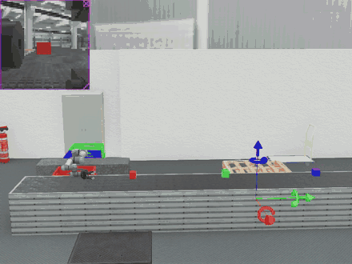

# UR5e Colour-Sorting Robot in Webots

A UR5e robot arm picks coloured boxes off a moving conveyor belt and drops each one into the crate of the same colour. A distance sensor triggers the grasp, an overhead camera identifies the colour with OpenCV, and a wrist position sensor confirms each move before the next step.

Built for the Advanced Robotics and Artificial Intelligence module, MSc Artificial Intelligence, Sheffield Hallam University (2025).



Full demo video: [docs/demo.mp4](docs/demo.mp4)

## What the system does

1. Boxes travel along a conveyor belt towards the arm.
2. The distance sensor on the gripper reads below 500 and the Robotiq 3-finger gripper closes on the box.
3. The camera frame goes through the colour pipeline and returns RED, GREEN or BLUE.
4. The arm rotates to the matching crate. The controller waits until the wrist position sensor passes -2.3 rad before opening the gripper.
5. The arm returns home and waits for the next box.

## Hardware in the simulation

| Component | Role |
|---|---|
| Universal Robots UR5e | 6-axis arm, 4 joints driven by the controller |
| Robotiq 3F gripper | Adaptive 3-finger grasp |
| Distance sensor | Detects a box at the pick point |
| Position sensor (wrist 1 joint) | Confirms the arm reached the drop or home pose |
| Camera | Captures the box for colour classification |
| Conveyor belt and 3 plastic crates | Red, green and blue sorting targets |

## Control logic

The controller runs a five-state machine on a 32 ms time step:

```
WAITING -> GRASPING -> ROTATING -> RELEASING -> ROTATING_BACK -> WAITING
```

A short counter between states gives the motors time to settle before the next command.

## Colour detection pipeline

| Step | Method | Why |
|---|---|---|
| Noise reduction | 7x7 Gaussian blur | Removes pixel noise before thresholding |
| Colour space | BGR to HSV | Separates colour (hue) from brightness |
| Lighting correction | Histogram equalisation on the V channel | Keeps detection stable under uneven light |
| Segmentation | HSV range masks for red (two hue bands), green, blue and yellow | One binary mask per colour |
| Decision | Weighted pixel count per mask, 500-pixel minimum | Rejects weak or empty frames |

## Project structure

```
ur5e-colour-sorting-robot-webots/
├── controllers/
│   └── colour_sorting_controller/
│       └── colour_sorting_controller.py   # state machine, sensors, OpenCV pipeline
├── worlds/
│   └── colour_sorting.wbt                 # Webots world: arm, conveyor, boxes, crates
├── docs/
│   ├── demo.gif
│   ├── demo.mp4
│   └── world.jpg
├── requirements.txt
└── README.md
```

## How to run

1. Install [Webots R2023a](https://cyberbotics.com/) or later.
2. Install the Python packages Webots will use:
   ```bash
   pip install -r requirements.txt
   ```
3. Clone this repository:
   ```bash
   git clone https://github.com/akinpelumiajayi/ur5e-colour-sorting-robot-webots.git
   ```
4. In Webots, open `worlds/colour_sorting.wbt` and press Play.
5. Optional: set the arm speed by adding a number to the controller arguments of the UR5e node, for example `1.5`. The default is `1.0`.

The world loads its PROTO files from the Webots GitHub repository, so the first launch needs an internet connection.

## Tech stack

Python, OpenCV, NumPy, Webots R2023a, UR5e, Robotiq 3F gripper

## Next steps

- Replace the fixed joint angles with inverse kinematics so the arm handles any crate position.
- Measure sorting accuracy and cycle time over 100 boxes.
- Add a reject bin for unknown colours. The fallback pose in the controller is a placeholder.

## Author

Akinpelumi Michael Ajayi, MSc Artificial Intelligence (Distinction), Sheffield Hallam University
[LinkedIn](https://www.linkedin.com/in/akinpelumi-michael-ajayi-) | [GitHub](https://github.com/akinpelumiajayi)

## Licence

MIT. See [LICENSE](LICENSE).
